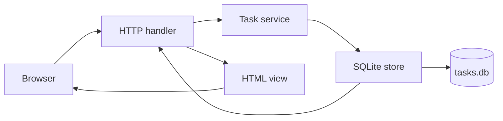

# System Architecture

## 1. Architectural Style
- Pattern: a small layered client-server application in one Python process.
- The HTTP layer handles the protocol, the service owns validation, the store owns SQL, and the view owns HTML. This keeps changes and tests localized without requiring several services for a small group lab.

## 2. Component Interaction Diagram (Mermaid)

## 3. Data Flow & Execution Lifecycle
1. Startup: `python -m taskboard.server` creates the store and its schema, then starts a threaded HTTP server.
2. Ingestion: the browser sends a GET request or a URL-encoded form POST. The handler checks the body size before reading it.
3. Processing: TaskService rejects a blank or over-120-character title and an assignee outside the five-member roster. Completion requires an existing task ID.
4. Persistence: TaskStore uses a fresh SQLite connection and parameterized queries. A successful write commits through the connection context manager.
5. Response: successful form writes redirect to `/` with 303. The HTML view escapes task text. Read endpoints return HTML or JSON.
6. Container lifecycle: the image runs as UID 10001 on port 8080. Mount a named volume at `/app/data` to keep the database after the container is removed. Without a volume, container-local task data is disposable.

## 4. Architecture Decision Records (ADRs)
- ADR-01 (SQLite): use a file database rather than a database server. This simplifies setup and persistent-volume demonstrations; write concurrency and scaling are limited.
- ADR-02 (Python standard library): avoid external runtime dependencies so the image is small and repeatable. `http.server` is sufficient for a local teaching lab; this is not a hardened public deployment.
- ADR-03 (layer boundaries): keep routing, validation, presentation and persistence in separate modules. The extra files are modest, and each concern can be tested independently.
- ADR-04 (local exposure): publish the container on `127.0.0.1`, since the task board has no authentication or authorization. Do not expose it as a public service without adding those controls and a production server.
